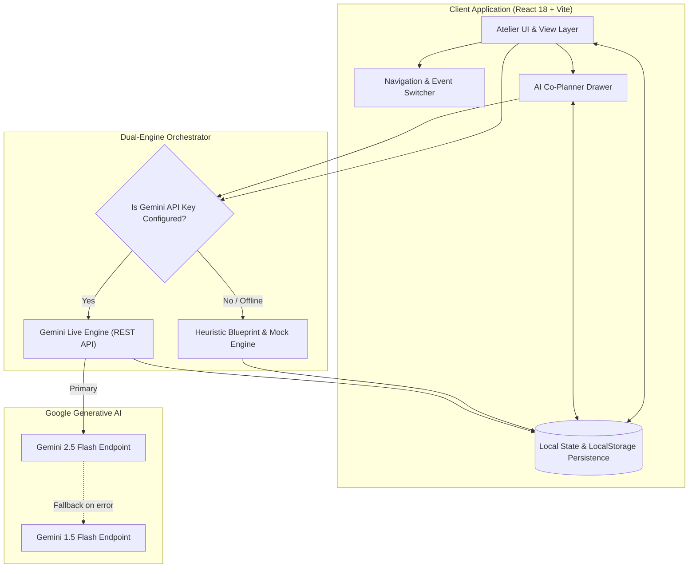
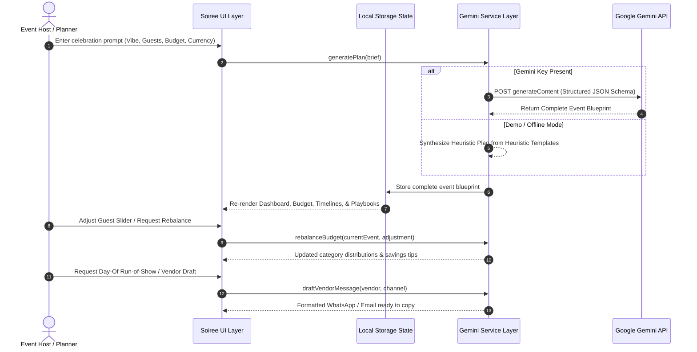
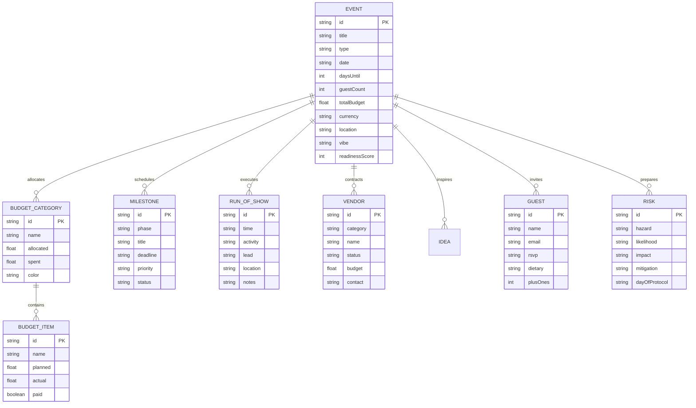

# Soirée — GenAI Luxury Event Planning Atelier

<div align="center">


<p align="center">
  <strong>An editorial, GenAI-orchestrated event planning studio transforming natural-language celebration briefs into living, actionable blueprints.</strong>
  <br />
  Tailored for weddings, milestone birthdays, and community festivals.
</p>

[Explore Features](#key-features) • [Architecture Diagrams](#system-architecture) • [Repository Structure](#repository-structure) • [Quick Start](#getting-started) • [Configuration](#configuration--api-keys)

</div>

---

## Overview

**Soirée** is an intelligent event planning studio built with an editorial luxury aesthetic. It bridges high-level creative vision with rigorous execution logistics. Instead of rigid spreadsheets, Soirée offers an interactive, living blueprint that adapts to budget constraints, guest fluctuations, and vendor negotiations in real time.

Powered by a **Dual-Engine Architecture**, Soirée connects natively with **Google Gemini (`gemini-2.5-flash` / `gemini-1.5-flash`)** for deep generative intelligence while maintaining an offline-first **Heuristic Fallback Engine** ensuring 100% functionality even without an API key.

---

## Visual Aesthetics & Design System

The atelier is crafted with a bespoke editorial aesthetic inspired by stationery and print design:
- **Color Palette**:
  - `Beige` (`#F5EDE0`) — Warm textural canvas
  - `Cream` (`#FAF5EC`) — Card and paper surface tones
  - `Sand` (`#E3D5BF` / `#EDE3D1`) — Subtle borders and structural dividing lines
  - `Burgundy` (`#6D1A2B`) & `Deep Burgundy` (`#4A0F1C`) — Primary brand, focal typography, and active elements
  - `Rose-Burgundy` (`#9B3347`) — Gentle badges and interactive accents
  - `Antique Gold` (`#B8935A` / `#E8D8B8`) — Accents, milestones, and high-readiness flourishes
  - `Charcoal Ink` (`#2B1B1B`) & `Muted Taupe` (`#7A6A5E`) — Legible editorial typography
- **Typography**: `Playfair Display` (editorial serif headings) paired with `DM Sans` (clean modern body).
- **Tactile Accents**: Custom SVG Wax-Seal brandmark, deckled card borders, luxury layered shadows, and festive burgundy confetti animations.

---

## System Architecture

### 1. High-Level System Architecture



### 2. Event Lifecycle & AI Interaction Flow



### 3. Core Domain Entity Model



---

## Repository Structure

```
Soiree/
├── .env.example                     # Environment template (VITE_GEMINI_API_KEY)
├── index.html                       # HTML5 entry with Google Fonts & meta tags
├── package.json                     # Project manifest and scripts
├── package-lock.json                # Locked dependency tree
├── postcss.config.js                # PostCSS configuration for Tailwind CSS
├── tailwind.config.js               # Theme extensions (colors, fonts, shadows)
├── vite.config.js                   # Vite tooling configuration
├── README.md                        # Atelier documentation & architecture guide
│
└── src/
    ├── main.jsx                     # Application bootstrap & DOM root render
    ├── App.jsx                      # Central state manager, event persistence & router
    ├── index.css                    # Tailwind directives & luxury utility classes
    │
    ├── components/
    │   ├── common/
    │   │   ├── Badge.jsx            # Dynamic semantic status badges & tags
    │   │   ├── Toast.jsx            # Non-blocking auto-dismiss notifications
    │   │   └── WaxSeal.jsx          # Bespoke SVG luxury brandmark
    │   │
    │   ├── navigation/
    │   │   ├── Navbar.jsx           # Brand header, event switcher & API key modal toggle
    │   │   └── SubNav.jsx           # Primary tabs & Co-Planner Drawer trigger
    │   │
    │   └── views/
    │       ├── LandingView.jsx      # Conception studio, brief prompt & quick blueprints
    │       ├── DashboardView.jsx    # Executive overview, countdown, readiness ring & KPIs
    │       ├── BudgetView.jsx       # SVG donut chart, spend tracker & AI rebalance engine
    │       ├── TimelineView.jsx     # Backward 5-phase schedule & Day-Of Run-of-Show
    │       ├── VendorsView.jsx      # Vendor pipeline, interview questions & AI drafter
    │       ├── IdeasStudioView.jsx  # 7-category curated brainstorm studio & AI generator
    │       ├── GuestsView.jsx       # RSVP tracker, dietary tags & per-head cost impact
    │       ├── RiskShieldView.jsx   # Hazard matrix, mitigation plans & emergency protocols
    │       ├── CoPlannerDrawer.jsx  # Slide-out contextual AI assistant for live plan mutations
    │       ├── PrintBlueprintModal.jsx # Editorial print stylesheet & 1-click PDF dossier export
    │       └── ApiKeyModal.jsx      # In-browser Gemini API key configurator & tester
    │
    ├── data/
    │   └── sampleEvents.js          # Full pre-packaged blueprints (Wedding, Birthday, Festival)
    │
    └── services/
        └── geminiService.js         # Gemini 2.5/1.5 API client & Heuristic Fallback engine
```

---

## Key Features

### 1. Conception & Natural Language Studio (`LandingView.jsx`)
- Accepts free-form vision statements, guests, budget, date, and currency (`USD`, `EUR`, `GBP`, `INR`, `CAD`, `AUD`).
- Provides 1-click quick-start blueprints:
  - **Amara & Julian's Provençal Vineyard Wedding**
  - **Leo's 30th Velvet & Vinyl Speakeasy**
  - **Solstice Lantern & Artisan Night Fair**

### 2. Executive Dashboard (`DashboardView.jsx`)
- Days-to-event live countdown timer.
- Circular animated **Readiness Score Ring** calculated dynamically from tasks, budget adherence, and RSVPs.
- High-level metric tiles: Budget Planned vs. Actual, Vendor Pipeline Status, RSVP counts.
- **Next 3 Recommended Actions** synthesized from pending milestones.

### 3. Smart Budget Planner & AI Rebalance (`BudgetView.jsx`)
- Interactive SVG Donut visualization with hover slices and legend breakdown.
- Itemized spend table with Paid/Pending indicators and actual difference tracking.
- **What-If Simulation Sliders**: Dynamically test budget and guest changes.
- Automatic **5-10% Contingency Reserve Shield**.
- **AI Rebalance Engine**: Automatically shifts underutilized funds to high-priority categories.

### 4. Backward Timeline & Day-of Run-of-Show (`TimelineView.jsx`)
- Backward-planned 5-phase roadmap: *Vision & Booking -> Logistics & Vendors -> Invitations & RSVPs -> Final Approvals -> Event Week*.
- Dual view modes: **Interactive Kanban Board** and **Chronological Timeline View**.
- Hour-by-hour **Event Day Run-of-Show** complete with activity, designated lead, location, and notes.

### 5. Vendor Checklist & AI Negotiator (`VendorsView.jsx`)
- Complete pipeline tracking across stages: *To Research -> Contacted -> Quoted -> Contracted -> Paid*.
- Category-specific vetting questions and contract red flags.
- **1-Click AI Message Drafter**: Produces personalized, polite negotiation messages ready for WhatsApp or Email.

### 6. Curated Ideas Studio (`IdeasStudioView.jsx`)
- Curated across 7 bespoke celebration vectors:
  - *Theme & Decor, Menu & Cocktails, Entertainment, Invites & Signage, Bespoke Favors, Photo Moments, Budget Hacks*.
- Save ideas, promote them directly into budget items or tasks, or click **"Surprise Me"** for fresh AI generations.

### 7. Guest List & Culinary Impact Tracker (`GuestsView.jsx`)
- Tracks Confirmed, Declined, and Pending RSVPs with plus-ones.
- Dietary restriction badges (Vegan, Gluten-Free, Halal, Nut Allergy, etc.).
- Real-time calculation of per-head food & beverage budget impact.

### 8. "Plan B" Risk Shield (`RiskShieldView.jsx`)
- Pre-empts weather hazards, vendor delays, power shortages, and transport bottlenecks.
- Matrix scoring (Likelihood vs. Impact).
- Preventive measures paired with step-by-step Day-Of emergency protocols.

### 9. Persistent AI Co-Planner Drawer (`CoPlannerDrawer.jsx`)
- Slide-out assistant accessible from any tab.
- Quick prompt chips (*"Cut budget by 10%"*, *"Suggest indoor rain plan"*, *"Add live saxophonist to run-of-show"*).
- Capable of modifying celebration state in-place with user confirmation.

### 10. Editorial Dossier & Print Engine (`PrintBlueprintModal.jsx`)
- Formats the entire celebration into a magazine-grade printable dossier.
- Includes cover sheet, executive summary, vendor contacts, and run-of-show.
- Built-in `window.print()` integration for 1-click PDF creation and clipboard sharing.

---

## Tech Stack & Dependencies

| Layer | Technology | Purpose |
| :--- | :--- | :--- |
| **Frontend Framework** | **React 18.3** | Component composition and hooks-based state management |
| **Build Tool** | **Vite 5.4** | Instant hot module replacement (HMR) and optimized bundling |
| **Styling** | **Tailwind CSS 3.4** | Utility-first styling with custom luxury color tokens |
| **Icons** | **Lucide React** | Clean, minimalist iconography |
| **Effects** | **Canvas-Confetti** | Celebratory visual micro-interactions |
| **AI Integration** | **Google Gemini API** | Multi-model fallback (`gemini-2.5-flash` → `gemini-1.5-flash`) |
| **Storage** | **Web LocalStorage** | Zero-latency, zero-database client persistence |

---

## Getting Started

### Prerequisites
- **Node.js**: v18.0.0 or higher
- **npm**: v9.0.0 or higher

### Installation

1. **Clone the repository**:
   ```bash
   git clone https://github.com/your-username/soiree-event-planner.git
   cd soiree-event-planner
   ```

2. **Install project dependencies**:
   ```bash
   npm install
   ```

3. **Configure Environment (Optional)**:
   Create a local `.env` file based on `.env.example`:
   ```bash
   cp .env.example .env
   ```
   Add your Google Gemini API key:
   ```env
   VITE_GEMINI_API_KEY=your_actual_gemini_api_key_here
   ```

4. **Launch the development server**:
   ```bash
   npm run dev
   ```
   Open your browser and navigate to:
   ```
   http://localhost:5173
   ```

---

## Configuration & API Keys

Soirée supports two convenient ways to authenticate with Google Gemini:

1. **Environment Variable (`.env`)**:
   Add `VITE_GEMINI_API_KEY` to your `.env` file before starting Vite.
2. **In-App Key Manager**:
   Click the **"Enter Key"** or **"Gemini Live / Demo"** pill in the top navigation bar at any time to paste your Gemini API key directly into the UI. The key is securely stored in your browser's `localStorage` and never leaves your device.
3. **Demo Mode (Zero Configuration Required)**:
   If no key is configured, Soirée automatically operates in **Demo Mode**. All features—plan generation, budget rebalancing, run-of-show creation, and vendor messaging—continue to function seamlessly using the built-in heuristic engine.

---

## Available Scripts

| Command | Action |
| :--- | :--- |
| `npm run dev` | Starts the Vite development server with HMR at `http://localhost:5173` |
| `npm run build` | Compiles and tree-shakes production assets into `dist/` |
| `npm run preview` | Runs a local static web server to preview the production build |

---

## Data Schema & Local Storage

Soirée persists all data locally in the browser:
- `soiree_saved_events`: Array of all created and customized event objects.
- `soiree_active_event_id`: ID of the currently selected celebration.
- `soiree_gemini_api_key`: User-supplied Gemini API key for live generation.

To reset the atelier to default sample events, clear your browser's application storage or click reset in the interface.

---

## Contributing

Contributions, bug reports, and suggestions are warmly welcomed!
1. Fork the project.
2. Create your feature branch (`git checkout -b feature/BespokeFeature`).
3. Commit your changes (`git commit -m 'Add BespokeFeature'`).
4. Push to the branch (`git push origin feature/BespokeFeature`).
5. Open a Pull Request.

---

## License

Distributed under the **MIT License**. See `LICENSE` for more information.

<div align="center">
  <br />
  <sub>Designed with care for unforgettable celebrations. Powered by Google Gemini.</sub>
</div>
